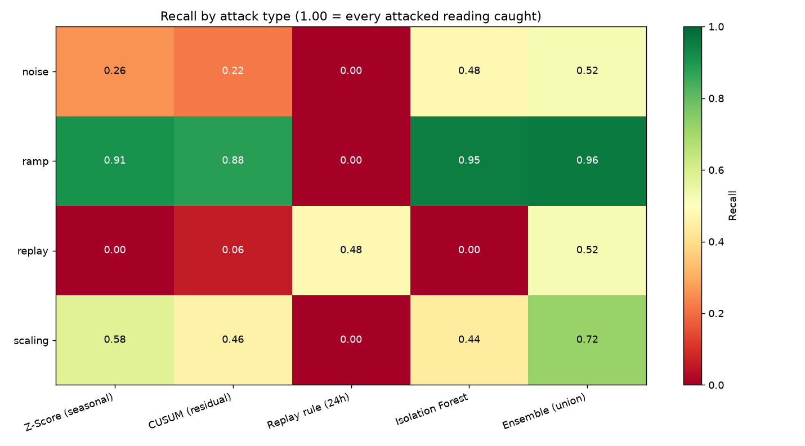
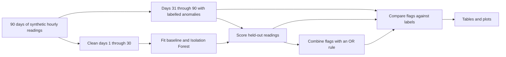

# Smart Meter Anomaly Detector

A Python experiment that compares statistical, rule-based and machine-learning detectors on synthetic hourly electricity readings. It measures how many anomalous readings each detector finds and how many false alarms it generates.



## Reproduce the experiment

Use Python 3.14. Create an environment with `python -m venv .venv`. Activate it with `.venv\Scripts\Activate.ps1` in PowerShell or `source .venv/bin/activate` on Linux.

```sh
python -m pip install -r requirements.txt
python main.py
python tests/test_pipeline.py
python tests/test_logging.py
```

Run these commands from the repository root. The experiment uses a fixed seed and needs neither a dataset download nor a device. It regenerates eight charts and two CSV tables in `outputs/` and writes four JSON Lines logs in `logs/`. Each command that initialises logging replaces the previous log files.

## Pipeline and methodology



The training baseline contains 720 clean readings. The chronological test set contains 1,440 readings, including 250 affected by non-overlapping scaling, ramp, replay or noise windows. The seasonal z-score groups readings by hour and weekday/weekend. CUSUM accumulates residuals from the seasonal mean. The replay rule compares repeating readings against a 24-hour lag. Isolation Forest uses features derived from the time series. The union flags a reading when any detector flags it. Evaluation counts individual readings. Detector alerts report the detector hypothesis. Injection labels are reserved for the evaluation and ground-truth log.

## Results on the fixed synthetic run

| Detector | TP | FP | TN | FN | Precision | Recall | F1 | False-positive rate |
| --- | ---: | ---: | ---: | ---: | ---: | ---: | ---: | ---: |
| Union | 184 | 68 | 1122 | 66 | 0.730 | 0.736 | 0.733 | 5.71% |
| Seasonal z-score | 133 | 12 | 1178 | 117 | 0.917 | 0.532 | 0.673 | 1.01% |
| CUSUM | 125 | 2 | 1188 | 125 | 0.984 | 0.500 | 0.663 | 0.17% |
| Isolation Forest | 141 | 64 | 1126 | 109 | 0.688 | 0.564 | 0.620 | 5.38% |
| 24-hour replay rule | 24 | 0 | 1190 | 226 | 1.000 | 0.096 | 0.175 | 0.00% |

The union caught the most anomalies and generated the most false alarms. CUSUM generated two false alarms and missed half the anomalous readings. See [overall counts](outputs/results_overall.csv) and [recall by anomaly type](outputs/results_per_attack.csv).

## Limitations and applications

The results are from one simulated meter and one fixed scenario. Some weekend baseline groups have eight observations, which limits the stability of seasonal estimates. The batch replay rule can label earlier readings once it observes enough consecutive matches. A streaming deployment would need to measure the resulting detection delay. A utility could adapt the pipeline to prioritise telemetry integrity checks, then measure alert burden and missed events on representative labelled data from multiple meters, seasons and operating conditions. The flags support investigation. Attribution would require independent evidence and context.

The default path processes synthetic data only. The optional research loader in `src/data_loader.py` has separate dependencies. See the [data notes](data/README.md).
