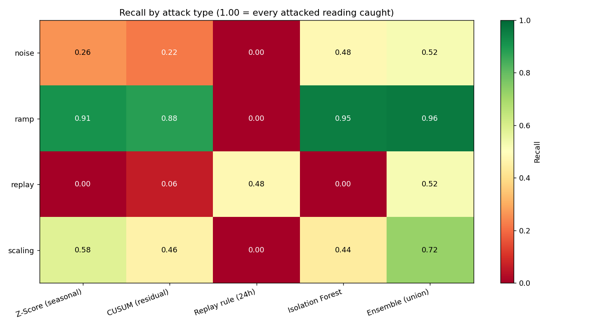
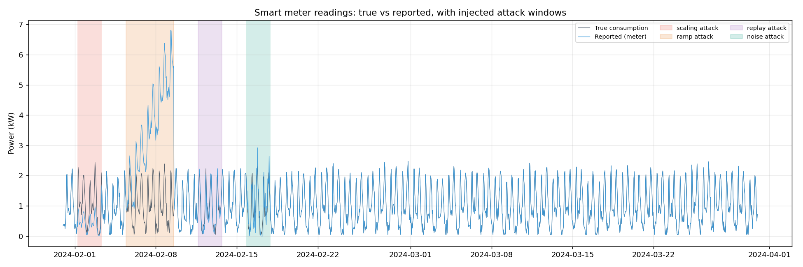

# Smart Meter False Data Injection Detector

A Python portfolio project comparing statistical detectors, a replay rule, and Isolation Forest on simulated household electricity readings.

## Scope

The default experiment uses one synthetic meter with hourly readings over 90 days. The first 30 days (720 readings) form a clean training baseline; the remaining 60 days (1,440 readings) are evaluated. Four non-overlapping attack windows contain 250 attacked readings: 17.4% of the test set.

These results describe this synthetic experiment only. They do not establish real-world smart-meter or solar-inverter detection accuracy, or identify electricity theft.

## Results

| Detector | Precision | Recall | F1 | False positive rate |
|---|---|---|---|---|
| Ensemble (union) | 0.730 | 0.736 | 0.733 | 5.71% |
| Z-Score (seasonal) | 0.917 | 0.532 | 0.673 | 1.01% |
| CUSUM (residual) | 0.984 | 0.500 | 0.663 | 0.17% |
| Isolation Forest | 0.688 | 0.564 | 0.620 | 5.38% |
| Replay rule (24h) | 1.000 | 0.096 | 0.175 | 0.00% |

| Attack | Z-Score | CUSUM | Replay rule | Isolation Forest | Ensemble |
|---|---|---|---|---|---|
| Scaling | 0.58 | 0.46 | 0.00 | 0.44 | 0.72 |
| Ramp | 0.91 | 0.88 | 0.00 | 0.95 | 0.96 |
| Replay | 0.00 | 0.06 | 0.48 | 0.00 | 0.52 |
| Noise | 0.26 | 0.22 | 0.00 | 0.48 | 0.52 |



The ensemble has the highest overall F1 and recall in this run, at the cost of more false positives. Both statistical detectors have higher overall precision and F1 than Isolation Forest; Isolation Forest has higher overall recall than either one and the highest noise recall among the individual detectors.

Z-score and Isolation Forest catch no replay readings in this run; CUSUM catches 3 of 50. The replay rule catches 24 of 50 with no false positives on this test set. These observations do not prove that these methods cannot detect other replay attacks.

One possible explanation for the forest's replay result is that replayed values remain plausible under the learned features. This is a hypothesis: feature-distribution analysis and controlled ablation experiments are needed to establish the cause.

## Implementation

- `src/data_loader.py`: synthetic hourly consumption and an optional UCI data loader.
- `src/attack_injector.py`: scaling (0.4 factor), ramp (+0.05 kW per step), 24-hour replay, and uniform noise (+/-0.8 kW).
- `src/detector.py`: seasonal z-score, CUSUM on seasonal residuals with reset on alarm, and a lag-matching replay rule.
- `src/ml_detector.py`: Isolation Forest using seven temporal and consumption features.
- `src/evaluate.py`: confusion counts, precision, recall, F1, false positive rate, and per-attack recall.
- `src/visualize.py`: eight plots.
- `main.py`: batch pipeline and CSV exports.
- `tests/test_pipeline.py`: 16 smoke and regression checks.

Seasonal expectations use 48 groups: hour of day and weekday/weekend. Some baseline groups contain only eight samples, so their estimates are uncertain. CUSUM accumulates seasonal residuals rather than the daily consumption cycle.

The replay rule compares readings with those 24 rows earlier, within 0.001 kW, and flags matching runs of at least three readings. The injector copies lagged **true** readings; once the replay window extends past 24 hours, the lagged reported readings may themselves have been replaced. This distinction matters when interpreting its partial recall.

Isolation Forest uses power, seasonal residual, sine/cosine hour encodings, 24-step difference, six-step rolling standard deviation, and one-step difference. Its contamination setting of 0.05 determines a threshold from training scores; it does not guarantee that 5% of unseen readings will be flagged.

## Run locally

```bash
git clone https://github.com/AzfarNajam/smart-meter-anomaly-detector.git
cd smart-meter-anomaly-detector
python -m venv .venv
```

Activate the environment on Windows PowerShell:

```powershell
.\.venv\Scripts\Activate.ps1
```

Or on macOS/Linux:

```bash
source .venv/bin/activate
```

Then:

```bash
python -m pip install -r requirements.txt
python tests/test_pipeline.py
python main.py
```

The pipeline writes four JSON-line logs under `logs/`, eight PNG charts and two CSV result tables under `outputs/`. Tests cover the fixed synthetic scenario; passing them does not validate performance on real data.



## Logging

| File | Contents |
|---|---|
| `detection.log` | Flagged readings, detector, score, and severity |
| `operational.log` | Pipeline status and baseline-size diagnostics |
| `audit.log` | Detector parameter initialization and changes |
| `ground_truth.log` | Injected attack windows and parameters |

In this simulator, detection log entries can copy the known `attack_type` label into `suspected_attack_type`. That field is ground-truth annotation, not an attack classification inferred by the detector.

## Limitations

- One synthetic meter, fixed seeds, one schedule, and one set of attack parameters. No real-data validation or uncertainty intervals are included.
- Synthetic daily patterns are hand specified; similarity to household consumption is not evidence of a measured calibration against UCI data.
- This is batch evaluation. Replay flags are assigned retrospectively to whole qualifying runs, including readings before the third match confirms the run.
- Lag features assume regularly spaced hourly rows. Missing timestamps require explicit handling before interpreting a 24-row lag as 24 hours.
- Lag and rolling features restart at the test boundary instead of carrying training history; initial missing feature values are filled with zero.
- The replay rule tests one lag. Its zero observed false positives do not establish perfect precision in deployment.
- Threshold and design choices were explored on this scenario. A separate untouched evaluation set is needed for stronger performance claims.
- No fleet-scale, Raspberry Pi, streaming, or production benchmark is included.

An optional `load_uci_dataset()` function exists in `src/data_loader.py` and requires `ucimlrepo`. To try it, import that function in `main.py` and replace the synthetic-data call. This path has not been validated here; inspect missing hours and choose a comparable chronological evaluation window before comparing metrics.

## Next steps

Validate on real household readings, evaluate multiple seeds and attack strengths on an untouched test set, add causal streaming evaluation, and compare multiple replay lags.
